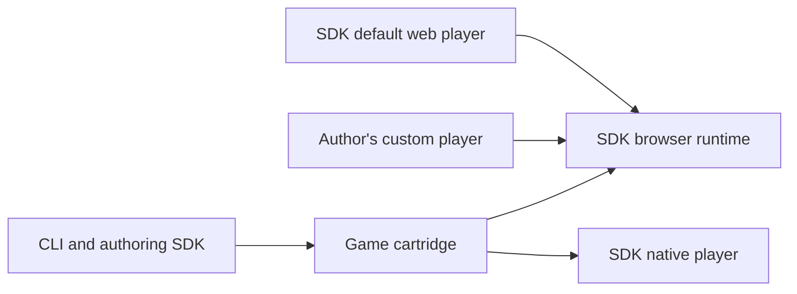

# Standalone authoring and embeddable player specification

Status: draft for review. This document records agreed product requirements and
proposed technical contracts. It does not describe the capabilities of the
currently released scaffolding preview. Implementation is tracked in the
[implementation plan](standalone-authoring-plan.md); current release behavior is
documented in [CLI distribution](cli-distribution.md).

## 1. Product outcome

A game author installs `byt`, creates a project, and plays their game using a
versioned SDK. The author does not download the Bytorio repository or build its
runtime. Compilers and other required authoring tools are obtained and managed
through the SDK distribution when needed.

The ordinary workflow is:

```text
byt new my-game
cd my-game
byt dev
```

The SDK also provides a browser runtime and a default embeddable web player as
separately usable modules. An author can use the default player, customize it,
or use the runtime directly to implement their own player.

## 2. Confirmed requirements and preferences

| Area                  | Required behavior                                                                                   |
| --------------------- | --------------------------------------------------------------------------------------------------- |
| Project layout        | `src/main.luau`, or `src/main.odin`, and a small root config                                        |
| Default language      | Luau; `--language odin` selects Odin                                                                |
| Default playback      | Open a browser tab                                                                                  |
| Initial SDK selection | Prefer the newest compatible installed SDK; if none is available, look up the newest compatible SDK |
| Existing projects     | Pin an exact SDK release; upgrades are explicit                                                     |
| Dependency downloads  | Obtain components on first run/build that needs them                                                |
| Dependency storage    | Shared per-user cache, reused across projects                                                       |
| Development command   | `byt dev` watches, rebuilds and reloads                                                             |
| Run command           | `byt run` builds/runs once, without a source watcher                                                |
| Web embedding         | Prioritize a JavaScript module mounted into a page element, with controls and events                |
| Default presentation  | Game inside a frame, with a compact toolbar outside the game                                        |
| Touch input           | D-pad, buttons, and tap/drag on phones and tablets                                                  |
| Control configuration | Presets with overrides, or fully author-defined controls and layouts                                |
| Custom players        | Authors can use the SDK runtime directly; no Bytorio checkout is required                           |

Virtual analog and twin-stick controls are deferred. This does not remove
existing supported keyboard, pointer or gamepad behavior. An iframe wrapper is
not the primary embedding interface. Replacing the runtime implementation,
interpreter, renderer or audio engine is not a requirement of this work.

## 3. Responsibilities

| Module                    | Responsibility                                                                                                            |
| ------------------------- | ------------------------------------------------------------------------------------------------------------------------- |
| CLI                       | Project creation, SDK resolution, downloads/cache, build/check orchestration, development sessions and exports            |
| Authoring SDK             | Language libraries, contracts, starter definitions, asset/build support and compatible toolchain declarations             |
| Browser runtime module    | Load and execute cartridges; own execution scheduling, workers, validation, rendering/audio integration and runtime state |
| Default web player module | Present the game, toolbar, menus, keyboard/pointer/touch controls and user-facing status                                  |
| Custom player             | Author-owned presentation and interaction, using the public browser runtime interface                                     |
| Native player             | Prebuilt application and required libraries supplied by the selected SDK release                                          |

The browser runtime module is a usable JavaScript interface over the complete
browser execution machinery. It is not merely the existing `runtime.wasm`
file, which is one internal implementation artifact. A custom player author
must not reconstruct the private worker protocol or manually assemble engine
Wasm modules to play a cartridge.



The default player and custom players use the same public runtime interface.
The default player has no privileged route to otherwise inaccessible runtime
features. Native and browser implementations retain the shared cartridge and
SDK contracts; the browser embedding interface does not require native callers
to use JavaScript.

## 4. Minimal project and defaults

Only game source and a small root config are primary authoring files. The
starter must already be playable and introduce the game lifecycle without
requiring an asset manifest, palette, font definition, HTML page or build script.
SDK defaults supply the starter's required resources.

The SDK release is the only version an ordinary game author must choose.
Default entry locations, language behavior, game title, supported profile,
display settings and player configuration are inferred or supplied by that SDK.
Explicit overrides remain available for larger projects. A non-default entry,
multiple source files, project assets and indexed content must not require
abandoning the CLI workflow.

Project creation must not copy the SDK implementation or player binaries into
the authored source tree. Cache/build/editor metadata may be generated, but must
be clearly distinguishable from files the author edits. Editor support must use
portable project references, without committing cache paths from one machine.
Exact config and lockfile shapes remain proposed work in section 12.

`byt new` must create a new directory exclusively and preserve existing user
files. Creating an Odin project must not install its compiler yet.

## 5. SDK resolution and reproducibility

For a new project without an explicit SDK selection:

1. Inspect locally installed SDKs with verified release metadata.
2. Select the newest compatible installed release. Do not contact the network
   merely to discover whether something newer exists when this succeeds.
3. If no compatible SDK is installed, query available releases and select the
   newest compatible release.
4. Record the exact selection in the project. Never persist a floating `latest`
   requirement as the game's resolved SDK.

For this proposed resolver, an installed SDK is a registered release with
verified manifest/starter metadata. Unneeded target payloads may still be absent.
A cached release listing alone does not register every listed SDK as installed.

An explicit SDK version takes precedence. Compatibility includes the CLI's
supported distribution protocol, selected language and advertised target
capabilities. A supported component being uncached does not make the SDK
incompatible: it is fetched on use. SemVer ordering and prerelease eligibility
must be defined before this selector ships; eligibility is an open policy in
section 12.

Default selection must support the complete create/build/play path for the
selected language and host, not merely writing a template. A legacy source-only
SDK can remain explicitly selectable for scaffolding, but must not become the
default full-authoring SDK when it cannot supply the needed player/tools.

Creation may fetch small release metadata and the selected starter definition
when necessary. It must not fetch players, compilers or full SDK payloads just
to write the starter. The distribution design must therefore make starter data
available independently of those larger payloads. With a compatible installed
SDK, creation needs no network access.

After creation, `dev`, `run`, `check`, `build` and `pack` use the exact project
selection. A newer CLI or SDK appearing online must not upgrade an existing
game. An explicit upgrade operation updates the selection and its dependency
record together; it must explain incompatible requirements rather than silently
rewriting game code or enabling another profile.

The dependency record must identify immutable release metadata and artifact
checksums without machine-specific paths. The same committed project must
resolve correctly on another supported host. Missing offline components produce
an actionable error naming what is missing; another SDK is not substituted.

## 6. Versioned SDK distribution

An SDK release is the compatibility unit for libraries, contracts, players,
browser runtime assets, Luau executor and authoring toolchain. These are logically
included in the SDK even when delivered as separate downloadable payloads.
Authors do not coordinate player and library versions independently.

Proposed distribution: a new versioned manifest protocol with small release
metadata and separately checksummed components. This is a technical proposal,
not a decision to put every platform's binary into one archive.

The manifest must describe:

- Exact distribution release identity and compatible CLI protocol/version range.
- Supported cartridge profiles, SDK/API and guest ABI values, and relevant limits.
- Starter definitions and defaults for each supported language.
- Authoring libraries, browser runtime and default-player entrypoints.
- Native player payloads and language tools by host/target capability.
- Each payload's identity, URL, size, digest, unpacking bounds and notices.

Download only components needed for the selected operation, language and target.
Browser development must not fetch native players or other hosts' compilers.
Luau authoring must not install Odin to compile the player or Luau executor.
An Odin build obtains its compatible compiler and any necessary linker/support
files through managed dependencies.

Cache entries must be verified before use, published atomically, and safe under
concurrent requests. Partial or corrupt downloads must not become usable SDKs.
Downloading a component must not execute arbitrary SDK installation hooks.
Project deletion must not invalidate another project's cached dependencies.

Published SDK releases remain immutable. New payloads require a new release;
existing release assets must not be replaced. Package formats, extraction rules
and bounds must work within the standalone CLI without requiring an external
archive utility. Preserve executable permissions, compatible loader paths,
signatures and third-party notices.

## 7. Commands and outputs

| Command                             | Contract                                                                               |
| ----------------------------------- | -------------------------------------------------------------------------------------- |
| `byt new <project>`                 | Select/pin the SDK and create the minimal Luau project                                 |
| `byt new <project> --language odin` | Create the equivalent Odin project, without fetching compiler/player payloads          |
| `byt dev`                           | Resolve required components, build, open the browser, then watch/rebuild/reload        |
| `byt run`                           | Resolve required components, perform one build and open the browser; no source watcher |
| `byt run --native`                  | Run using the selected SDK's native player on a qualified host                         |
| `byt check`                         | Check the game using the selected SDK and managed tools                                |
| `byt build`                         | Produce requested export targets using that SDK; default target selection remains open |
| `byt pack`                          | Produce a cartridge with the selected SDK's contracts and limits                       |

Project commands work from the project directory without repeating its path.
Explicit path use and existing source-CLI workflows need a migration strategy.
Additional option and upgrade-command spellings are not settled by this draft.

Commands identify the selected SDK and target, show cache/download progress,
and make missing or incompatible dependencies actionable. Ordinary first use
must not appear to hang while silently obtaining a toolchain.

`run` being non-watching does not mean its browser server exits immediately
after opening the page. The session must keep necessary assets available and
shut down its owned server/processes cleanly when ended. `dev` coalesces changes
and prevents overlapping builds. Failed builds report useful source diagnostics
and retain the last valid game until a successful build can replace it.

Both browser and native exports must be portable and self-contained for their
documented target. A static web export needs no CLI, SDK cache, source checkout
or Bytorio release server at play time. Native exports include the player,
required libraries and notices. Packaging must copy qualified prebuilt players
without requiring the author to rebuild or re-sign them.

## 8. Public browser runtime interface

The following capabilities are requirements; JavaScript method and event names
must be reviewed as an interface before being frozen:

| Capability             | Required behavior                                                                                      |
| ---------------------- | ------------------------------------------------------------------------------------------------------ |
| Create/load            | Create an independent runtime session and load a URL or supported local cartridge input                |
| Lifecycle              | Start, pause/resume, reload/restart, unload and dispose predictably                                    |
| Presentation           | Connect to an author-supplied presentation surface without imposing the default player's page layout   |
| Input                  | Accept the SDK's normalized digital and pointer inputs from a player implementation                    |
| Audio/host interaction | Support browser user-gesture activation and existing host integrations through documented capabilities |
| State/events           | Expose loading, ready, running, paused and failure state, plus useful progress/error notifications     |
| Diagnostics            | Offer optional coherent runtime/frame diagnostics to development tools and tests                       |

No required global DOM IDs, page-wide styling, private worker messages or
`globalThis.playerStatus` object may form the embedding contract. Private
implementation details remain inside the runtime module. The default player
must not reach around this interface.

Sessions must support independent mounting and disposal on the same page.
Listeners, workers, audio and pending asynchronous work belong to their session;
disposing one must not stop another. Keyboard/pointer ownership must not hijack
the surrounding website. Existing saves, text entry, content streaming, graphics
capabilities and error/watchdog recovery must survive the extraction.

Keep simulation ticks distinct from rendered-frame ticks in diagnostics. A
frame's image/hash and frame metadata must describe that same rendered state.
Embedding must preserve the SDK's timing, memory and execution contracts.
Changing the player UI must not weaken sandbox validation or grant a cartridge
host filesystem/network access.

Runtime entrypoints and their workers/Wasm/audio/shader assets must resolve from
the exported SDK asset location, including subdirectory hosting. The ordinary
embedding route must work as browser JavaScript without npm, a framework or a
Bytorio checkout. Document MIME, origin, secure-context and browser requirements.

## 9. Default player and touch controls

The SDK provides a production player mounted into an author-selected element.
It presents a framed game and a compact toolbar outside the game surface.
Developer performance overlays, renderer internals, raw logs and test controls
must not dominate production playback. Development diagnostics remain available
through a separate opt-in presentation. Exact toolbar contents and visual design
are review items, not implied approvals in this spec.

The player must support keyboard/pointer use and responsive phone/tablet layouts,
including fullscreen, orientation changes and device safe areas. Presentation
must respect the game's declared display dimensions and aspect behavior.

Touch controls support:

- D-pad directions and configurable buttons.
- Tap/drag pointer interaction with correct logical game coordinates.
- Simultaneous direction/button touches and reliable release/cancellation.
- Presets with binding, label and layout overrides.
- Fully author-defined controls/layouts as an alternative to presets.

Control bindings use supported SDK input identifiers. Labels and positioning must
not bake one game's actions into the runtime. Changing a control layout must not
require editing the player implementation. Pointer capture, cancellation, lost
focus and visibility changes must not leave controls held down. Releasing one
input source must not release a binding still held by another touch or keyboard
source. UI adaptation must not change simulation timing or invent analog inputs.

Authors can customize supported presentation/control extension points or omit
the default player entirely and implement their own against the runtime module.
The default player's styles and listeners must stay scoped to its instance.

## 10. Compatibility and migration

The source checkout remains a contributor workflow and an explicit development
provider. It must never be an automatic fallback when a downloaded SDK is
incomplete or unsupported.

Current distribution protocol 1 contains text SDK assets without players or
toolchain resolution. Preserve its published assets and supported scaffolding
use. Full authoring requires a distribution with the necessary capabilities;
an incomplete legacy SDK must produce a clear explanation rather than a hidden
source build.

The current preview's embedded-starter shortcut must not bypass the new SDK
selection rules. Document this changed creation behavior when migrating users.

Today, `console.json.sdk` identifies a cartridge SDK/API version associated with
a profile. It is not the downloadable SDK bundle's release version. Do not
silently reinterpret existing values. A versioned config extension and an
explicit migration must distinguish distribution pins from cartridge metadata.
Existing profiles, custom entries/assets/content and game code remain usable.

The project dependency record currently pins only an SDK bundle. Extend it
deliberately for immutable manifests, players and tools; do not write absolute
cache paths into it. Keep CLI releases independent from SDK releases and retain
the existing CLI archive names, raw aliases and short mise installation format.

## 11. Acceptance criteria

Release qualification must demonstrate:

1. On a qualified clean host, only `byt`, normal OS facilities and a supported
   browser are initially available. Both supported game languages can create,
   check, build, run and pack without Node, Bun, mise, CMake, Emscripten, Python,
   globally installed compilers or the Bytorio checkout as author prerequisites.
2. Creation selects an installed compatible SDK before making a network lookup;
   an empty cache fetches only needed starter/selection metadata. An explicit
   version and incompatible/offline cases have deterministic results.
3. First browser use fetches only its required components. Native use fetches
   the matching native payload. Repeated/offline use reuses verified cache data.
4. Two projects pinned to different SDKs remain independent, including after CLI
   upgrades. Concurrent/interrupted/corrupt downloads cannot publish partial
   installations or execute unverified payloads.
5. `run` performs no automatic rebuild; `dev` rebuilds/reloads and recovers from
   errors. A source change and an asset/content change both reach playback.
6. The default player and a custom player load the same cartridge using the same
   runtime interface. The custom example contains no engine source or private
   worker/DOM protocol. Mounting two sessions and disposing one works correctly.
7. Phone/tablet tests cover D-pad plus button multitouch, tap/drag coordinates,
   cancellation/focus loss, resizing/orientation and fullscreen.
8. Preset overrides and an explicit custom layout both work without player
   source edits. Production playback is clean; diagnostics are separately usable.
9. Native/browser exports play after relocation without the developer's cache,
   source checkout or build tools. Static hosting works under a subdirectory.
10. Existing independent replay expectations, malformed-cartridge checks, resource
    bounds, saves, text input, audio recovery and watchdogs continue to pass.

Qualification applies to each advertised host/language/target combination.
CLI availability alone does not establish full authoring support. The pinned
Odin compiler currently has no Intel Mac host asset; resolving that gap is
required before advertising Odin authoring there. Native player payloads also
need their own target qualification.

## 12. Open decisions and proposed technical details

These are not preferences already supplied by the author:

- **Custom-site development:** plain HTML/CSS/JS sites and framework-hosted sites
  must be able to embed the runtime. How `byt dev` serves a custom shell or
  launches/co-ordinates an external framework's dev server is still undecided.
  Basic runtime embedding must not depend on that decision.
- **Project/dependency schemas:** retaining `console.json` and evolving
  `byt.lock.json` are migration-friendly proposals. Final field names, schema
  versions and which generated metadata is committed need review. Avoid adding
  author-maintained boilerplate for internal tool/player details.
- **Release eligibility:** define how preview SDKs participate in “newest
  compatible,” including an explicit preview opt-in if that is selected.
- **Build defaults and release scope:** select the default `build` targets and
  publish a qualified host/language/target matrix. Resolve Intel Mac compiler
  availability before promising the same Odin experience there.
- **Player details:** approve the toolbar, preset catalogue, style extension
  points, and initial mobile layouts before implementing the production shell.

Virtual sticks, runtime-engine replacement, automatic SDK upgrades, mandatory
framework scaffolding and a new general plugin system are outside this scope.
